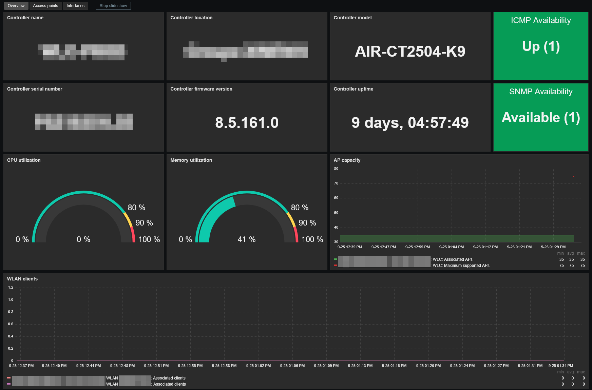
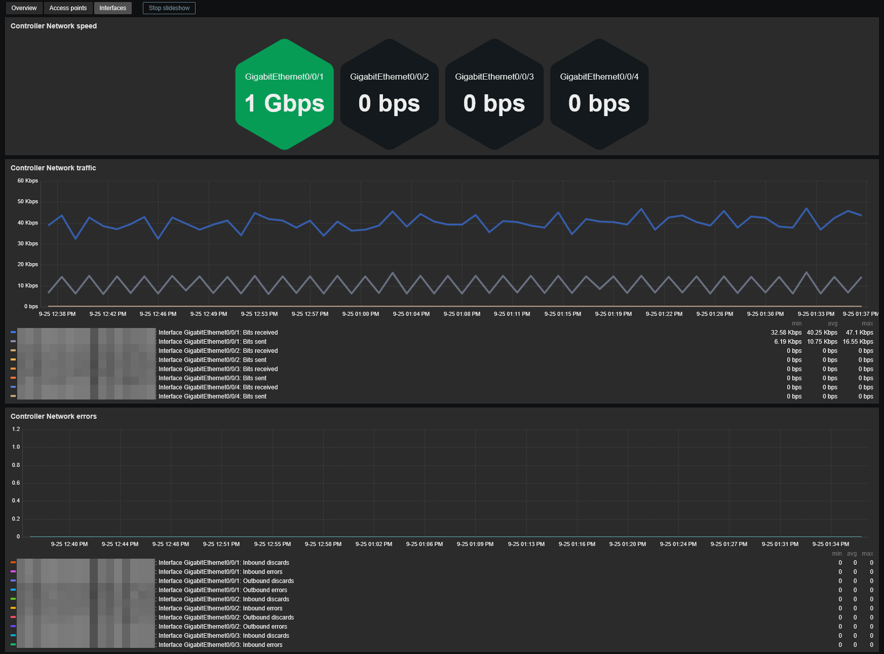

# Template Cisco Wireless LAN Controller by SNMP
## Source
Built from scratch by E-MSN. 
## Compatibility
This template is designed for monitoring Cisco wireless controller (WLC) running AireOS via SNMP. 
It has been tested on the following models:
- AIR-CT2504-K9 (wireless controller)
- AIR-CAP3702E-E-K9 (access point)
## Usage
Import template as usual: **Data Collection -> Templates -> Import** 
Add your switch using **SNMPv2** or **SNMPv3**, then adjust the macro values if needed. 
> **Note:** You must set the `{$WLC.AP.MIN}` macro to the expected number of access points for the trigger to work correctly.
## Dashboards preview
**Overview:**

**Acces points:**

**Interfaces:**

