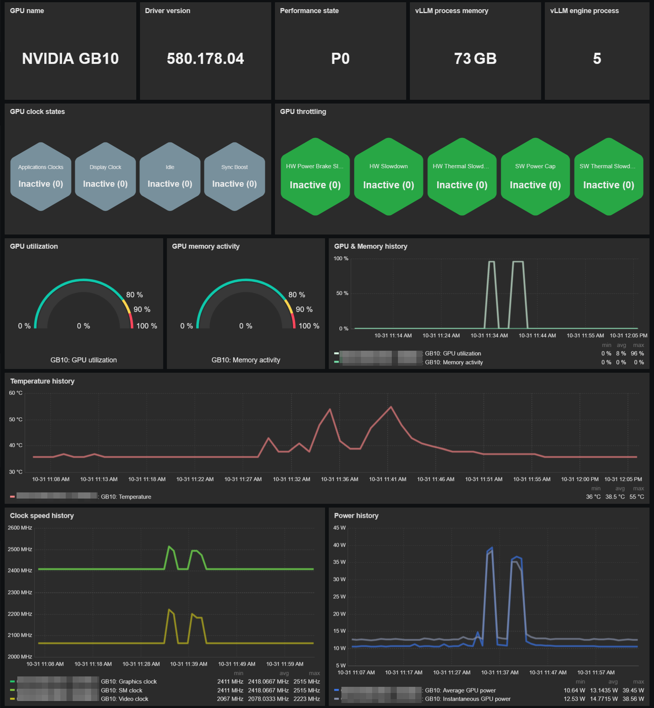
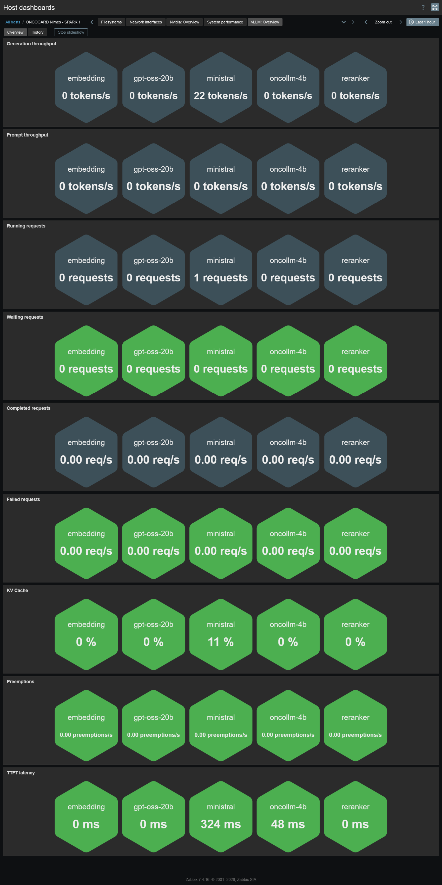
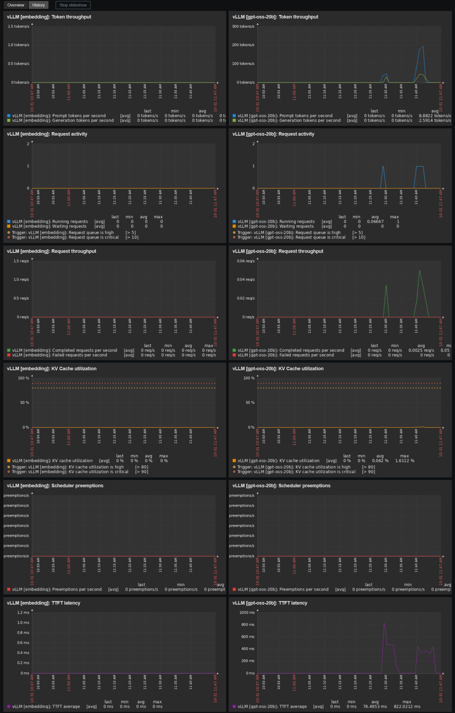

# Template Nvidia DGX Spark by Zabbix agent 2 active
## Source
Built from scratch by E-MSN.<br>
Special thanks to [@Grujowmi](https://github.com/Grujowmi) for helping me identify and understand the key vLLM metrics.

## Compatibility
These templates are designed to monitor NVIDIA DGX Spark systems and vLLM inference engines using Zabbix agent 2 in active mode.<br>
It has been tested with:
- Ubuntu 24 running v7.0.0-1019-nvidia aarch64 kernel
- NVIDIA DGX Spark Version v7.6.0
- NVIDIA driver v580.178.04
- Zabbix agent2 v7.4.16

## Prerequisites
Two Zabbix agent 2 configuration files are required to enable monitoring of the NVIDIA GB10 GPU and vLLM inference engines.<br>

### Step 1: gb10-smi.conf
The ***'gb10-smi.conf'*** file defines the UserParameters required to execute NVIDIA GPU monitoring commands.<br>
Download and copy [gb10-smi.conf](./config/gb10-smi.conf) to ***'/etc/zabbix/zabbix_agent2.d/'***

### Step 2: vllm.conf
The ***'vllm.conf'*** file defines the UserParameters required to collect metrics from vLLM instances.<br>
A configuration generator is provided to simplify the setup.

Download [generate_vllm_conf.sh](./config/generate_vllm_conf.sh) to your home directory.<br>
Then execute:<br>
```sudo bash generate_vllm_conf.sh```

Move the generated ***'vllm.conf'*** file to ***'/etc/zabbix/zabbix_agent2.d/'***

> [!IMPORTANT]
> Run the configuration generator again whenever you add, remove, or modify your vLLM Docker containers.

### Step 3: restart Zabbix agent 2
Apply the configuration changes by restarting the agent:<br>
```sudo systemctl restart zabbix-agent2.service```

## Usage
Import template as usual: **Data Collection -> Templates -> Import**<br>
You will get 2 templates:
- Nvidia GB10 by Zabbix agent 2 active
- vLLM by Zabbix agent 2 active

Add your NVIDIA DGX Spark using the following templates:
- **Linux by Zabbix agent active** (optional)
- **Nvidia GB10 by Zabbix agent 2 active**
- **vLLM by Zabbix agent 2 active**

Adjust the macro values if needed.

> The NVIDIA GB10 and vLLM templates can be used independently, depending on your monitoring requirements.

## Dashboards preview
### NVIDIA
**Overview:**


### vLLM
**Overview:**

**History:**

