# Template Xen Orchestra by HTTP
## Source
This template is based on the original templates written by Thorsten Liepert and has been extensively extended and reworked.<br>
https://github.com/bufanda/zabbix--template-xenorchestra

## Compatibility
This template is designed for monitoring Xen Orchestra and XCP-ng environments through the Xen Orchestra REST API.<br>
It has been tested with:
- Xen Orchestra REST API 0.39.0
- XOA 6.8.2
- XCP-ng 8.3.0

**Compatibility with older REST API versions is not guaranteed.**

## Known limitations
The following features are included in the template but have not yet been tested:
- Backup monitoring (including jobs, schedules and backup repositories)

## Prerequisites
You need to generate an authentication token to access the Xen Orchestra REST API.<br>
> Because this template collects a large amount of information, the API token must be associated with an admin account.<br>
> A dedicated admin account is recommended (**Don't use the root account!**)

### Step 1 (optional): Increase the token validity limit
By default, Xen Orchestra limits the maximum token validity period to 6 months.<br>
If you want to use a longer validity period, connect to your XOA appliance through SSH and edit ***'/etc/xo-server/config.toml'***<br>
Add the following configuration at the end of the file:<br>
```[authentication]
maxTokenValidity = '2 years'
```

Then restart the Xen Orchestra service:<br>
```systemctl restart xo-server```

### Step 2 : Create a token
Connect to XOA with your web browser and authenticate with the administrator account you will use for Zabbix API access.<br>
Open ***'REST API doc'*** from the Xen Orchestra web interface (XO-5 web UI).<br>
Go to ***'Users'***, open ***'POST /users/{id}/authentication_tokens'*** then click on the ***'Try it out'*** button.<br>
Adapt the request body to your needs. For example:<br>
```
{
    "client": {
        "id": "zabbix"
    },
    "description": "Token for Zabbix Monitoring",
    "expiresIn": "2 years"
}
```

The response will contain the authentication token ID.<br>
Save it in a secure place, as it will be required by Zabbix.

## Usage
Import template as usual: **Data Collection -> Templates -> Import**<br>
You will get 3 templates:
- Xen Orchestra by HTTP (main template)
- XCP-ng Host via Xen Orchestra
- XCP-ng VM via Xen Orchestra

Add your Xen Orchestra Appliance using the **'Xen Orchestra by HTTP'** template, then configure at least the required values:
- **{$XOA.AUTH.TOKEN}** : authentication token ID created in the previous step
- **{$XOA.URL}** : Xen Orchestra URL (https://XOA_IP or https://XOA_FQDN)

The template will automatically discover the XCP-ng hosts and virtual machines managed by Xen Orchestra.

## Dashboards preview
### Xen Orchestra
**Overview:**
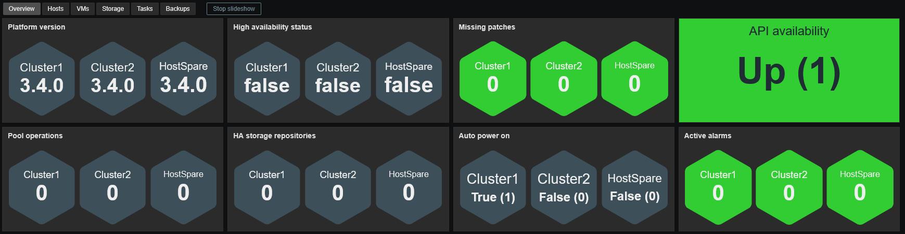
**Hosts:**
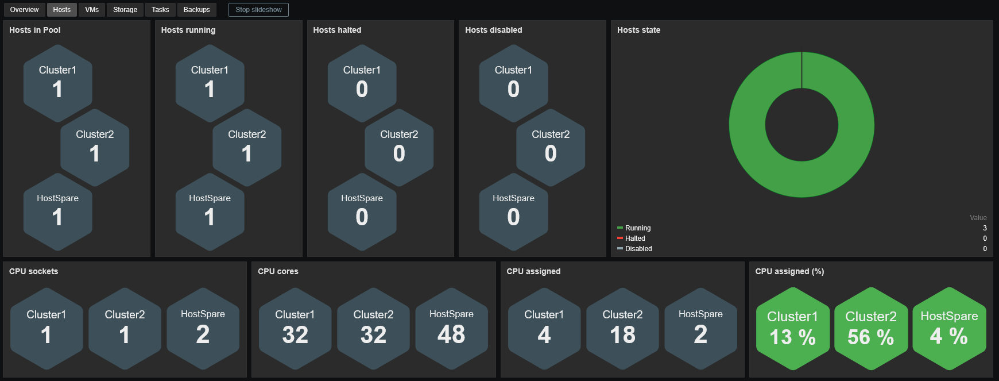
**VMs:**
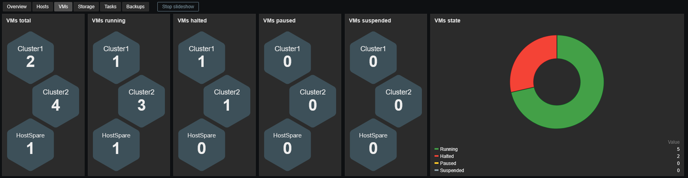
**Storage:**
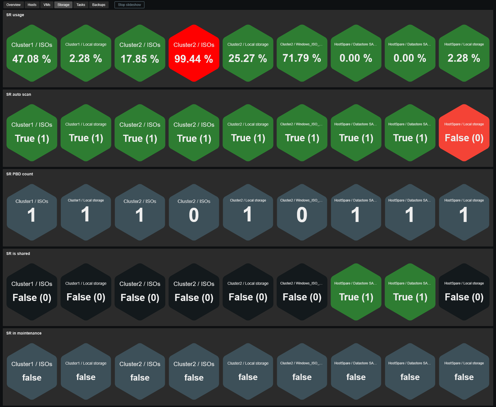
**Tasks:**
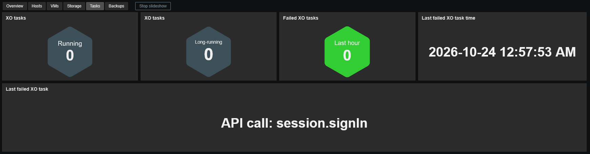
**Backups:**
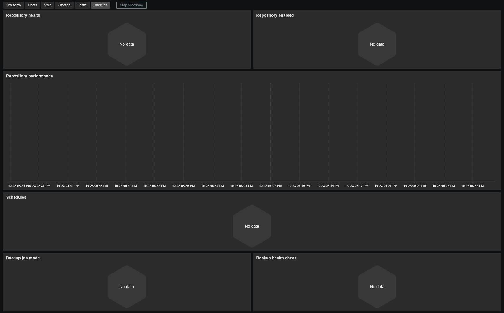
### XCP-ng Hosts
**Overview:**
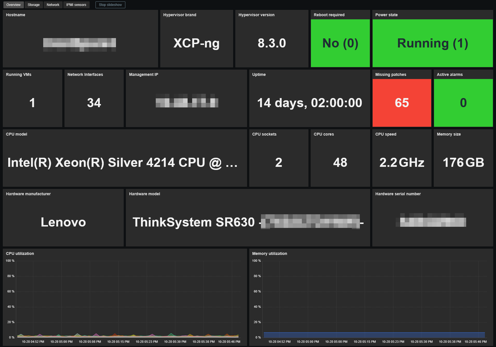
**Storage:**
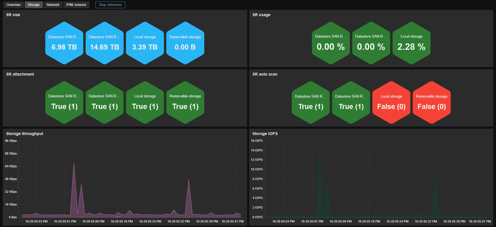
**Network:**
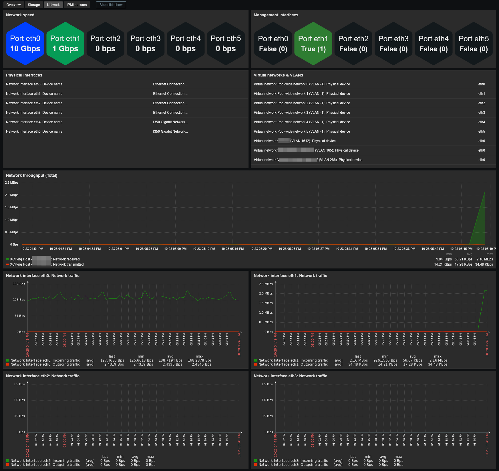
**IPMI sensors:**

### XCP-ng VMs
**Overview:**
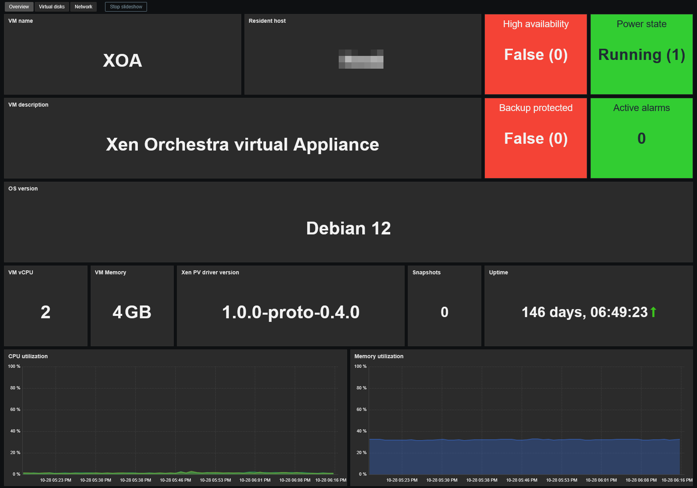
**Virtual disks:**

**Network:**
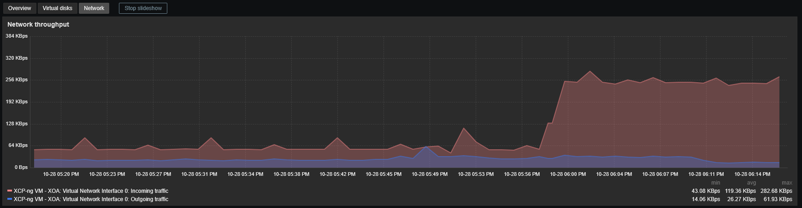
