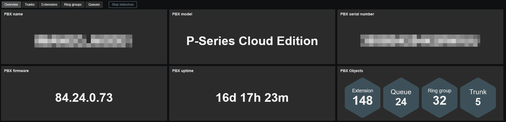
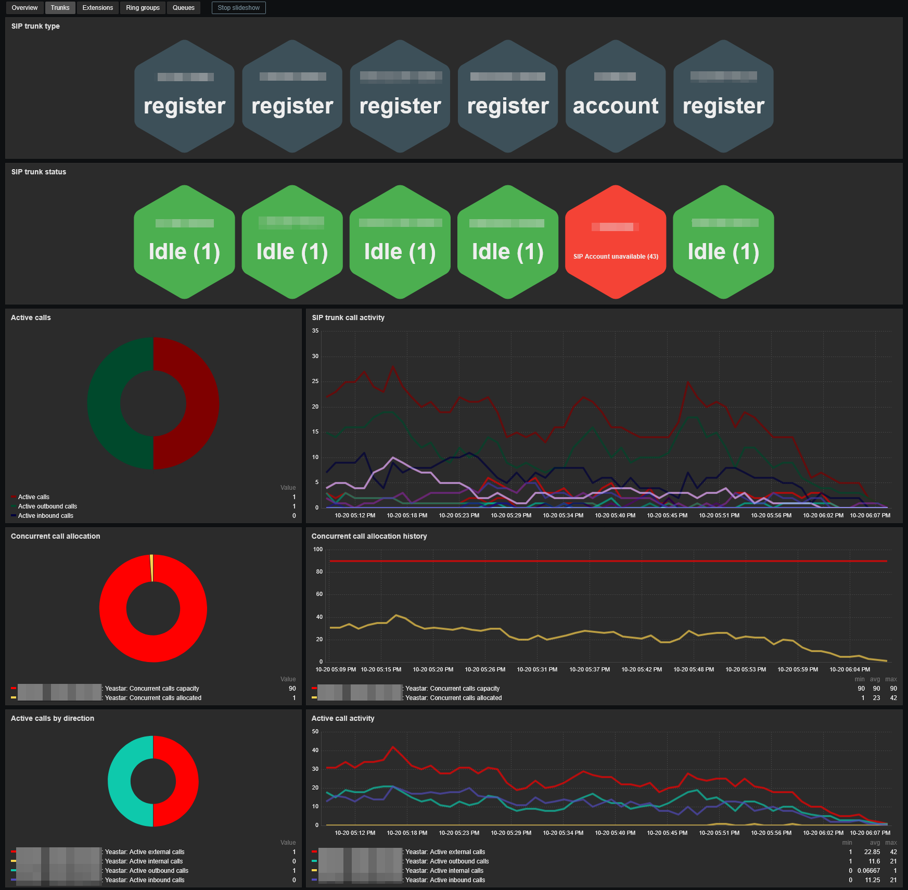
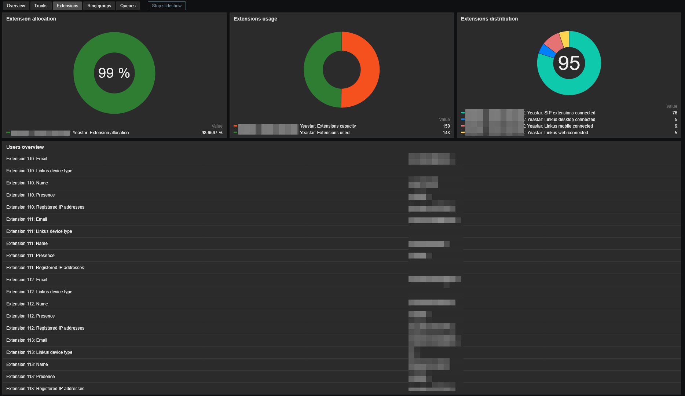
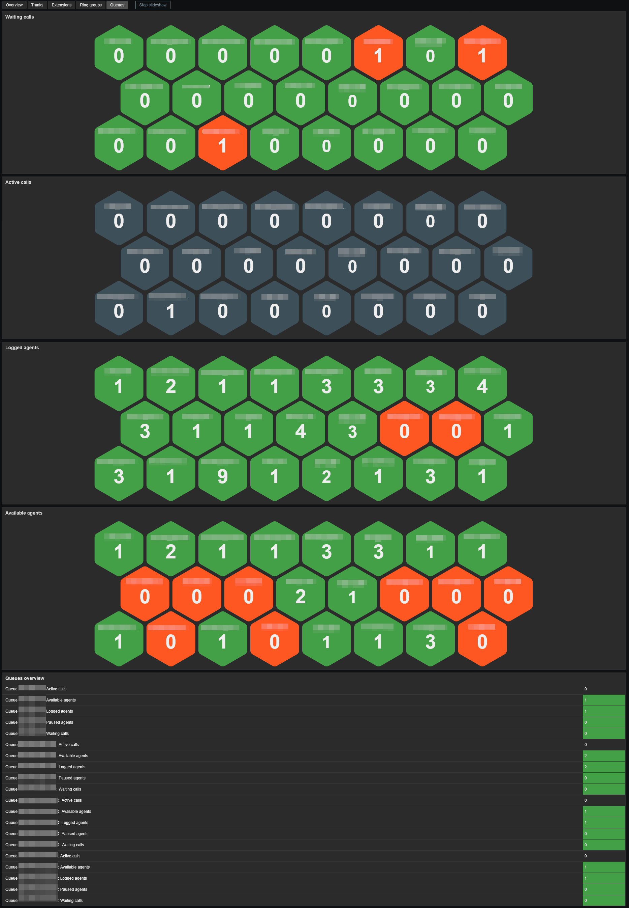

# Template Yeastar P-Series Cloud by HTTP
## Source
Built from scratch by E-MSN.
## Compatibility
This template is designed for monitoring Yeastar P-Series Cloud PBX. 
It has been tested on the following firmware:
- from 84.24.0.73 to 84.24.0.122

**Compatibility with older PBX firmware is not guaranteed.**

## Prerequisites
You need to enable the REST API in your PBX. 
Go to Integrations -> API and enable API. You will need the client ID and its secret key. 
> Use IP restriction to limit who can acces your PBX.

## Usage
Add your PBX using the **'Yeastar P-Series Cloud by HTTP'** template, then configure at least the required values:
- **{$YEASTAR.CLIENT.ID}** : API Client ID
- **{{$YEASTAR.CLIENT.SECRET}}** : API Client secret
- **{$YEASTAR.URL}** : PBX's base URL (ie: https://pbx.example.yeastarcloud.com)

## Dashboards preview
**Overview:**

**Trunks:**

**Extensions:**

**Ring groups:**

**Queues:**

